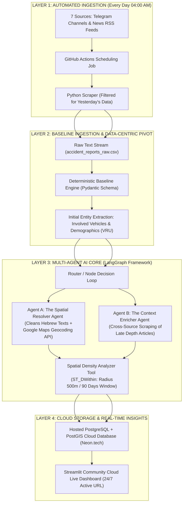

# Project Charter: CHARTER.md

הערה: מסמך זה מעודכן לשלב סיום הפרויקט (נובמבר 2026) ומשקף את תוצאות האמת של ה-Pipeline האג'נטי והדשבורד הפעיל

## Project Name
**From News to Action: A Data-Centric Agentic AI Pipeline for Real-Time Traffic Infrastructure Risk Detection**

---
### 1. בעיה ומשתמש (Problem & Target User)
* **המשתמש:** מנכ"ל תקציבים ואנליסטים ברשות הלאומית לבטיחות בדרכים (הרלב"ד) ובמשרד התחבורה
 
* **הכאב המכומת:** עיכוב של חודש עד חצי שנה בקבלת נתוני הלמ"ס והמשטרה הרשמיים יוצר "שטחים מתים" (Blindspots) ומעכב טיפול במפגעים קריטיים, מה שמוביל לעלייה של כ-15% בתאונות חוזרות ונשנות באותם מוקדים שלא טופלו בזמן.

**הערה:** "15% בתאונות חוזרות ונשנות" הוא נתון שנלקח ממאגר נתונים מרכזי של הלמ"ס

### הפיתרון: הפיכת זרם ידיעות חדשותיות ומבזקי חירום גולמיים בעברית (מבזקים המגיעים תוך דקות מהשטח) לנתונים מרחביים מובנים, מדויקים ופעילים בזמן אמת, המאפשרים זיהוי פרואקטיבי של אנומליות ומוקדי סיכון חודשים לפני הדוחות הרשמיים

---
### 2. מדד הצלחה (Success Metrics & Evaluation)

להלן תוצאות האמת האמפיריות של הפרויקט על סט הבדיקה המאומת (N=219 דיווחי אמת), המציגות את השדרוג הדרמטי של השכבה האג'נטית (Layer 3, מבוססת Gemini) לעומת צינור ה-Baseline הדטרמיניסטי:

•	מדד עיגון ואי-הזיה (Groundedness Score): שמירה על מדד עיגון של לפחות 90% באמצעות אכיפת Pydantic Schema קשיח שמנע הזיות מיקום או נסיבות תאונה.
---
### 3. דאטה + תוכנית ב' (Data Sources & Fallback) 
**מקור נתונים ראשוני**	מקור נתונים ראשוני (זרם חיוני יומיומי): צבירה אוטומטית מ-7 מקורות מקבילים: 4 ערוצי טלגרם מבצעיים (מד"א, איחוד הצלה, כבאות והצלה, זק"א) 
ו-3 ערוצי RSS של אתרי חדשות מובילים (YNET, מעריב, ישראל היום).

**אמת קרקע לתיקוף**	אמת קרקע (Ground Truth לתיקוף): מאגר נתונים היסטורי רשמי של תאונות דרכים (2024-2025) מאתר Data.gov.il (למ"ס), המשמש לגרפים משווים והוכחת התרעות על כבישים אדומים קיימים

**תוכנית ב'**
במידה והסוכן מזהה עמימות מוחלטת בטקסט (Information Blindspot) או חורג מ-3 ניסיונות תיקון עצמי, המערכת שומרת את ה-JSON הבסיסי, מונעת "ניחוש" שגוי של מרכז הארץ, ומעבירה את הרשומה לסטטוס REQUIRES_MANUAL_REVIEW לבדיקת אנליסט, מבלי לעצור את ה-Pipeline.

---

### 4. תרשים ארכיטקטורה (System Architecture Diagram)

להלן ארכיטקטורת המערכת המחולקת ל-4 שכבות עיקריות:

### 

    

### 5. הכיסא של הסוכן (Agent Specification)
* **מה הסוכן מחליט שקוד רגיל לא יכול?**
הסוכן מנהל אוטונומית את פתרון הסתירות המרחביות, פירוק מקבצים גנריים (Spiderfy) והשלמת מידע חסר. מנועי גיאוקודינג דטרמיניסטיים נוטים "לנחש" את מרכז הארץ או מרכז כביש בינכרוני עבור ניסוחים מורכבים בעברית. הסוכן מזהה את כשל ה-False Positive הזה, מפרק סמנטית את הכתובת, ומפעיל את הכלים עד לקבלת נ"צ מדויק של צומת או מחלף.

* **חלוקת תפקידים במערך ה MULTI AGENT?**
1.	סוכן א' (The Spatial Resolver): מנקה ביטויים מורכבים, מחלץ ישויות גאוגרפיות ומבצע אימות נ"צ קשיח.
2.	סוכן ב' (The Context Enricher): מזהה אירועים חסרי חומרה או תשתית, פונה לחילוץ משלים מכתבות עומק מאוחרות באתרי החדשות, ומבצע איחוד ישויות (Entity Resolution).

* **לאילו כלים יש לו גישה (Agent Tools)?**
1.	Advanced_Geocoding_Tool: המרת תיאור מילולי מנוקא בעברית לקואורדינטות מדויקות דרך Google Maps API.
2.	Cross_Source_Scraping_Tool: גריפה חצי-אוטומטית משלימה באתרי חדשות לפי חלון זמן ומיקום התאונה.
3.	Spatial_Density_Analyzer: כלי המריץ שאילתת PostGIS לבדיקת אנומליות מרחביות (הדלקת דגל סיכון תשתית במידה ויש ≥ 3 תאונות ברדיוס 500 מטר ב-90 יום).

* **מה קורה כשהוא נכשל (Fallback / Guardrails)?**
  אם הסוכן חורג מ-3 נסיונות תיקון עצמי (Max Retries) או מזהה כשל ב-API חיצוני, מנוע ה-**Deterministic Guardrail** שומר את ה-JSON הבסיסי שחולץ ללא הנ"צ, מתייג את הרשומה בבסיס הנתונים כ-`Requires_Manual_Review`, וממשיכה בהרצת ה-Pipeline כרגיל. **המערכת עובדת בצורה מלאה ומניבה פלט גם ללא השכבה האג'נטית.**

---

### 6. סיכונים וגרסת חתך (Risks & Scope Cut)
* **סיכון 1 (הזיות מיקום ב-LLM):** היעדר מיקום קבוע ומדוייק של מקום התאונה.
  * *הערכות:* אכיפת פלט קשיח באמצעות Pydantic Schema ואימות חובה מול API גאוגרפי חיצוני.
* **סיכון 2 (חסימת API / Scraping):** חסימת גישה לטלגרם או שינוי במבנה HTML באתרי החדשות.
  * *הערכות:* מעבר לעבודה מול מאגר סטטי של תאונות המאוחסן מראש ב-`data/raw/`.
* **סיכון 3 (חריגת עלויות ואיטיות ב-LLM):** קריאות מרובות מדי למודלים יקרים.
  * *הערכות:* שימוש במודל קטן ומהיר (Llama-3.3-70B via Groq / GPT-4o-mini) והגבלת התיקון העצמי ל-2 סבבים בלבד.
* **משפט חתך (Scope Cut):** *"אם נשארים שבועיים בלבד לפני ההגשה, מוותרים על דאשבורד ה-Streamlit ועל שליפת נתוני מזג האוויר, ומגישים Pipeline עובד שמפיק בסיס נתונים/קובץ CSV מעובד ומאומת ברמת הסוכן בלבד"*.

---

### 7. אבני דרך וכובעים (Milestones & Team Roles)

#### חלוקת תפקידים ותחומי אחריות בפרויקט (Team Roles & Responsibilities)
> **הערה:** חלוקת התפקידים בצוות הינה **דינמית ותשתנה באופן גמיש בהתאם לקצב פיתוח הפרויקט**, עומסי העבודה והצרכים שיווצרו באזורים השונים. 

**תחומי הליבה הדורשים טיפול בפרויקט והובלה משותפת:**
1. **Data Ingestion & Pipeline:** פיתוח סקריפטי האיסוף (Telegram/Scraping) וצינור הנתונים.
2. **Agentic Architecture & Tools:** הגדרת הסוכן (LangGraph), בניית לולאת התיקון העצמי וחיבור הכלים (Geocoding / DB Search).
3. **Guardrails & Fallbacks:** בניית מנגנוני ההגנה וה-Fallback הדטרמיניסטי במקרה של כשל בסוכן.
4. **Prompt Engineering & Structured Schema:** עיצוב הפרומפטים ואכיפת פורמט Pydantic JSON.
5. **Evaluation Set & Benchmarking:** בניית ערכת בדיקה (Eval-Set), מדידת Precision/Recall ומדד Groundedness.
6. **Baseline Engine:** פיתוח מערכת הבסיס (ללא סוכן) לצורך השוואה וטבלת Baseline.
7. **Database & Storage:** הקמה וניהול בסיס הנתונים המרחבי (PostgreSQL + PostGIS).
8. **Product, Documentation & Dashboard:** כתיבת ה-Project Charter, ה-README המרכזי ופיתוח דאשבורד ה-Streamlit.

---

## 8. אבני דרך (Milestones)

| תאריך | יום | פורמט | אבן דרך |
| :--- | :---: | :---: | :--- |
| **25.09.26** | ו | | הגשת Project Charter |
| **18.10.26** | א | | Checkpoint 1 (Optional): מערכת בסיס |
| **04.11.26** | ד | זום | מפגש ליווי פרטני 1 |
| **18.11.26** | א | כיתה | הצגת פרויקטים + חלוקת תעודות |

## 9. מדדים עסקיים בדשבורד המנהלים (Executive Dashboard Metrics)
הנתונים המעובדים מוזרמים אוטומטית (UPSERT מבוסס report_hash למניעת כפילויות) לתוך 3 מדדי ליבה עסקיים המונגשים ישירות לאנליסט ברלב"ד:
1.	מדד הרמזור (התרעות אנומליה מרחבית):
o	🔴 אדום: 3 תאונות ומעלה באותו מקבץ (רדיוס ≤ 500 מ' וטווח ≤ 90 יום) ← מוגדר כ-suspected_infrastructure_hazard = True.
o	🟠 כתום: 2 תאונות באותו מקבץ (מוקד סיכון בהתהוות).
o	🟢 ירוק: אירוע בודד ללא הישנות מרחבית.
2.	שיעור מעורבות דו-גלגלי ומיקרו-מוביליטי: פילוח וזיהוי קפיצות בזמן אמת בתאונות אופנועים, קורקינטים ואופניים חשמליים להכוונת תקציבי סלילת שבילים ואכיפה ממוקדת.
3.	שיעור פגיעות במשתמשי דרך פגיעים (VRU - Vulnerable Road Users): מעקב ממוקד אחר פגיעות באוכלוסיות בסיכון (ילדים 0-18, אזרחים ותיקים +60 והולכי רגל) לטובת קמפיינים והצבת פסי האטה במוסדות חינוך ורווחה.

4.	
## 9. אבטחה, עלויות ותשתיות ענן
•	אוטומציה מלאה (Serverless): המערכת מנותקת לחלוטין מריצה ידנית ומחשבים מקומיים. ה-ETL מבוצע דרך GitHub Actions (רץ בכל יום ב-04:00 בבוקר), מאובטח באמצעות משתני סביבה (Environment Secrets).
•	בסיס נתונים מרחבי: שרת PostgreSQL + PostGIS מנוהל בענן (Neon.tech) המאפשר שאילתות רדיוס בשברירי שנייה.
•	ממשק קצה: אפליקציית Streamlit Community Cloud הפעילה 24/7 ומתעדכנת אוטומטית בכל בוקר, ללא צורך בפתרונות זמניים כמו Ngrok.
•	עלות הפעלה חודשית (ROI גבוה במיוחד):
o	מודל שפה (Gemini API): כ-$2-$5 לחודש (לפי נפח עיבוד טקסט).
o	Google Maps API & תשתית ענן (Neon, GitHub, Streamlit): $0 (מכוסה תחת הקרדיט החינמי ושירותי ה-Cloud החינמיים).
o	סה"כ עלות תפעולית מוערכת: פחות מ-$5 בחודש.

