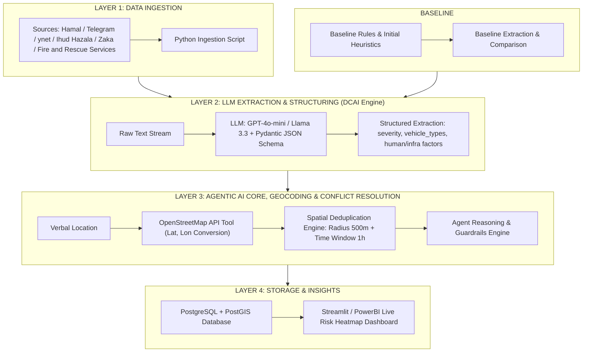

# Project Charter: From_News_to_Action [CHARTER_E_V1.md]

> **Note:** The contents of this charter are subject to change based on project progress, data availability, and outcomes from each project phase.

## Project Name

**From News to Action: A Data-Centric Agentic AI Pipeline for Real-Time Traffic Infrastructure Risk Detection**

---

### 1. Problem & Target User

* **Target User:** Head of Budgeting at the National Road Safety Authority (NRSA / Ralbad) or the Ministry of Transport.
* **Quantified Pain Point:** The Head of Budgeting at the National Road Safety Authority loses critical analysis time waiting for processed, official data from the Central Bureau of Statistics (CBS) and the Police. This delay creates "blindspots" and postpones the identification and treatment of critical road hazards, leading to an estimated **15% increase in recurring accidents** at untreated hazard locations.

**Note:** The figure "15% increase in recurring accidents" is derived from a primary dataset from the CBS (Central Bureau of Statistics).

---

### 2. Success Metrics & Evaluation

* **Hazard Response Latency:**
  1. **Real-Time Data Display:** Within ~24 hours from data ingestion.
  2. **Accident Recurrence:** Highlighting road hazards defined as recurring incidents occurring at the same location (within a 0.5 km radius) over a 90-day window.
* **Data Extraction Quality (Precision & Recall):** Achieving at least **85% Precision and Recall** in extracting complex, structured entities (Structured NER) from unstructured Hebrew text on a validated evaluation dataset (Eval-Set).
* **Groundedness Score:** Maintaining a Groundedness Score of **at least 90%** (utilizing a dedicated evaluation benchmark to prevent hallucinated accident locations or circumstances).

---

### 3. Data Sources & Fallback

* **Primary Data Source:** Real-time data collected via APIs from online news portals (Maariv, YNET, JSG, Israel Hayom, Hamal) and Telegram channels (MDA, Ihud Hatzalah, Fire and Rescue Services).
* **Fallback Plan:** If monitoring online news sites is blocked, the pipeline will fall back to alternative sources (Kan 11, Walla, Channel 14). If these are also restricted, a historical accident dataset stored in a shared CSV / Google Drive will be utilized.

Additionally, if the accident location remains unpopulated after geocoding (via Google Maps API), a basic lookup table covering ~30 geographic areas will serve as a baseline location.

---

### 4. System Architecture Diagram

The system architecture is structured into 4 main layers, alongside the Baseline comparison:

---

### 5. Agent Specification

* **What does the Agent decide that standard code cannot?**
  The agent autonomously manages **Spatial Conflict Resolution & Contextual Enrichment**. When duplicate or conflicting reports regarding the same incident exist (e.g., a YNET article reporting "an accident on Route 4 near Geha" vs. a Telegram post reporting "an accident near Givat Shmuel Interchange"), standard deterministic code fails or creates duplicates. Through cross-referencing, the agent evaluates the timestamp and geographic location to determine the precise coordinates.

* **Which Agent Tools does it access?**
  1. `Geocoding_Tool`: Calls the OpenStreetMap / Nominatim API to convert Hebrew verbal descriptions into spatial coordinates (Lat/Lon).
  2. `Spatial_Deduplication_Tool`: Queries PostgreSQL/PostGIS to identify existing events within a 500m radius and a 1-hour time window (500m represents the tool's precision threshold).
  3. `Weather_API_Tool`: Fetches weather and lighting conditions at the time and verified location of the incident.

* **What happens upon failure (Fallback / Guardrails)?**
  If the agent exceeds 3 self-correction attempts (Max Retries) or encounters an external API failure, the **Deterministic Guardrail** engine saves the raw extracted JSON without coordinates, flags the database record as `Requires_Manual_Review`, and continues running the pipeline. **The pipeline remains fully functional and produces output even without the agentic layer.**

---

### 6. Risks & Scope Cut

* **Risk 1 (LLM Location Hallucinations):** Lack of fixed, accurate accident coordinates.
  * *Mitigation:* Strict output enforcement via Pydantic Schema and mandatory verification against an external Geocoding API.
* **Risk 2 (API Blocks / Scraping Failures):** Access restrictions on Telegram or HTML structure changes on news sites.
  * *Mitigation:* Transitioning to a static historical accident dataset stored locally under `data/raw/`.
* **Risk 3 (LLM Latency & Cost Overruns):** Excessive calls to expensive LLM endpoints.
  * *Mitigation:* Utilizing small, fast models (Llama-3.3-70B via Groq / GPT-4o-mini) and limiting self-correction loops to a maximum of 2 retries.

* **Scope Cut Statement:** *"If only two weeks remain prior to submission, the Streamlit dashboard and weather data retrieval will be cut. The final submission will focus on a fully functional backend pipeline producing a verified, agent-processed database/CSV."*

---

### 7. Team Roles & Responsibilities

> **Note:** Role distribution within the team is **dynamic and will flexibly adapt** based on development velocity, workload distribution, and emerging project requirements.

**Core Areas of Ownership & Shared Leadership:**
1. **Data Ingestion & Pipeline:** Developing ingestion scripts (Telegram/Scraping) and the data pipeline.
2. **Agentic Architecture & Tools:** Defining the agent (LangGraph), constructing self-correction loops, and integrating tools (Geocoding / DB Search).
3. **Guardrails & Fallbacks:** Building defensive mechanisms and deterministic fallbacks in case of agent failure.
4. **Prompt Engineering & Structured Schema:** Designing prompts and enforcing Pydantic JSON schemas.
5. **Evaluation Set & Benchmarking:** Constructing the evaluation dataset (Eval-Set) and benchmarking Precision/Recall and Groundedness metrics.
6. **Baseline Engine:** Developing the baseline system (non-agentic) for benchmarking and comparison tables.
7. **Database & Storage:** Setting up and managing the spatial database (PostgreSQL + PostGIS).
8. **Product, Documentation & Dashboard:** Authoring the Project Charter, central README, and developing the Streamlit dashboard.

---

## 8. Milestones

| Date | Day | Format | Milestone |
| :--- | :---: | :---: | :--- |
| **25.09.26** | Fri | | Project Charter Submission |
| **18.10.26** | Sun | | Checkpoint 1 (Optional): Baseline System |
| **04.11.26** | Wed | Zoom | Individual Mentoring Session 1 |
| **08.11.26** | Sun | Zoom | Individual Mentoring Session 2 |
| **18.11.26** | Sun | Class | Project Presentations + Certificate Distribution |
